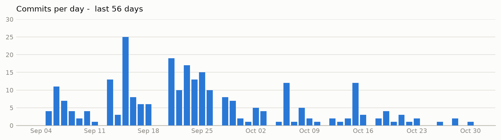

# TieTech Innovations

**We build the technology shaping what's next.**

_AI, DevOps & Product Engineering_

[Website](https://tietech.co) · [LinkedIn](https://www.linkedin.com/company/tietech-innovations/) · [GitHub](https://github.com/TieTechInnovations) · [Contact](mailto:info@tietech.co)

---

## About

TieTech Innovations creates AI-powered products, intelligent agents, and production-ready software that solve real business problems. We engineer AI products and the infrastructure behind them.

From AI and automation to backend engineering, cloud infrastructure, and DevOps, we turn ambitious ideas into reliable, scalable products for startups and enterprises.

We work as small, senior teams that own a problem end to end, from architecture and delivery through deployment, monitoring, and on-call support. An engineering team, not an agency of generalists.

## What we do

- **AI & ML Engineering** — machine learning, LLM integration, RAG pipelines, and AI-driven platforms
- **DevOps & Infrastructure** — cloud architecture, containerisation, infrastructure as code, CI/CD, monitoring, and on-call support
- **Software Development** — full-stack web and mobile applications
- **Blockchain Development** — smart contracts and decentralised applications
- **Design** — UX/UI, prototyping, and 3D & visual design
- **Quality Assurance** — testing and release validation

## Industries

Healthcare · Fintech · Retail & E-Commerce · Gaming & Metaverse · Logistics · Smart Cities · Manufacturing · Education

## What we work with

| Area | Technologies |
|---|---|
| AI / ML | Machine Learning, LLM Integration, RAG, PyTorch, TensorFlow |
| Infrastructure | AWS, Docker, Kubernetes, Terraform |
| Languages & frameworks | TypeScript, Python, Go, Rust, Node.js, React, Next.js |
| Data | PostgreSQL, MongoDB, DynamoDB, Redis |
| Blockchain | Solidity, Ethereum, Smart Contracts |

## Work with us

Have a product to build or infrastructure to run? Reach us at [info@tietech.co](mailto:info@tietech.co) or visit [tietech.co](https://tietech.co).

Follow us on [LinkedIn](https://www.linkedin.com/company/tietech-innovations/) for practical AI insights, real-world case studies, engineering lessons, and a behind-the-scenes look at what we're building.

---

## 📊 Commit activity

<!-- STATS:START -->
In the last 56 days: **339** commits across **10/58** active repos (**57** private).

<picture>
  <source media="(prefers-color-scheme: dark)" srcset="assets/commit-graph-dark.png">
  
</picture>

**Most active repos**

- `chatbot-saas` — 82 commits
- `social-media-pipeline` — 70 commits
- `minaya-backend` — 58 commits
- `tietech-website` — 34 commits
- `minaya-docs` — 27 commits

**Top contributors**

- ZainMustafaaa — 258 commits
- sanaejaz — 21 commits
- MajidImtiaz — 16 commits
- actions — 15 commits
- abdullahumar2002 — 14 commits

**Primary languages**: `JavaScript`, `TypeScript`, `Python`, `Solidity`, `Kotlin`
<!-- STATS:END -->

Last updated: 2026-10-06 22:30 UTC

